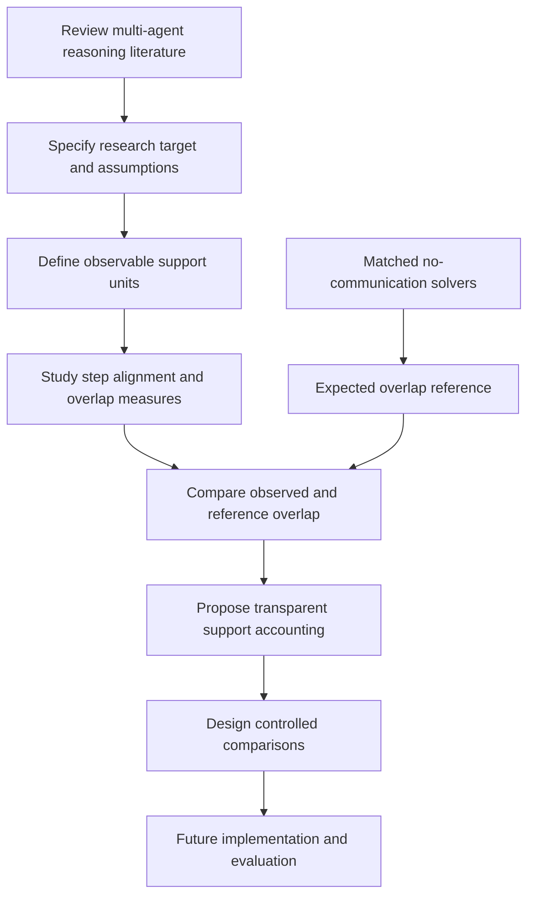

# CAVE-EoT: Literature Review and Research Design

**A final-year project (PFE) on evidence dependence in multi-agent large language model reasoning.**  
**Current stage: literature review and research design — implementation and experiments have not started.**

CAVE-EoT investigates a focused question: when multiple LLM agents agree on an answer, are they contributing meaningfully distinct supporting derivations, or repeatedly relying on overlapping support? The research direction is to study observable derivation overlap relative to a task-matched no-communication reference, then evaluate whether dependence-aware support accounting improves aggregation decisions.

> **Status and evidence note:** This repository documents the literature review, research questions, preliminary research gap, proposed design, and planned evaluation. It does not claim that the CAVE-EoT algorithm has been implemented, validated, or shown to improve accuracy. The proposed method is a research hypothesis to be tested.

## At a glance

- **Area:** Multi-agent systems, LLM reasoning, aggregation, dependence and uncertainty.
- **Research stage:** Literature review / problem formulation / experiment design.
- **Primary unit of interest:** Observable supporting steps or derivations, not just final answers.
- **Central comparison:** Observed overlap versus overlap among comparable solvers that have not communicated.
- **Primary caution:** Similar text is not proof of copying, and independent generation does not guarantee independent errors or evidence.

## Research question

Can an aggregation layer use step- or derivation-level overlap, calibrated against a matched no-communication reference, to identify *excess shared support* and improve answer selection beyond simpler aggregation baselines under controlled conditions and comparable compute budgets?

### Sub-questions

1. **Representation:** What is a meaningful support unit, and how reliably can equivalent or partially shared steps be aligned across agents?
2. **Reference:** How should the no-communication reference preserve task, model, prompt, sampling and budget conditions?
3. **Aggregation:** Can repeated decisive support be discounted without penalizing honest common derivations or rewarding irrelevant verbosity?
4. **Evaluation:** Does the mechanism improve decision quality and dependence diagnostics, and what is its additional token, latency and implementation cost?

## Conceptual research pipeline

The diagram describes the **research direction**, not a completed system.

## What the literature review currently suggests

The review organizes prior work along four axes:

1. **Communication and debate protocols:** independent sampling, full or sparse communication, iterative debate and cross-model exchange.
2. **Decision and aggregation rules:** majority vote, confidence/reliability weighting, LLM judges, learned calibration and trajectory-aware methods.
3. **Dependence representation:** answer-level agreement, semantic similarity, reasoning-step extraction, argument structures, and statistical dependence models.
4. **Evaluation:** answer quality, correct-to-wrong and wrong-to-correct changes, dependence diagnostics, resource costs, robustness and failure analysis.

A key lesson is that agreement, correctness and independence are different properties. A majority can repeat a shared flaw; however, honest solvers can also arrive at the same correct canonical derivation. Any proposed dependence measure therefore needs an explicit target and a reference distribution, and must be tested for both false positives and false negatives.

## Closest comparisons to investigate

The literature review identifies several close neighbors. CAVE-EoT should not claim novelty merely because it uses majority aggregation alternatives, reasoning extraction, semantic deduplication or dependence-aware aggregation.

| Work / family | Existing focus described in the review | Question for CAVE-EoT |
|---|---|---|
| **AgentAuditor** | Reasoning-tree construction, alignment and branch auditing | What does a calibrated no-communication reference add beyond extracting and auditing steps? |
| **CAGE-CAL** | Matched independent/post-communication graphs and learned answer calibration | How does a derivation-overlap target differ from learned answer/agent calibration? |
| **DarkForest** | Candidate aggregation, reliability and dependence discounts | Does step-/chain-level accounting add value beyond answer-level aggregation? |
| **Slim-SC** | Thought-level semantic redundancy reduction | Is reference-calibrated excess overlap needed beyond semantic deduplication? |
| **ARGORA** | Argument-graph representation and weighting | What is the precise target and support-credit rule beyond graph structure? |
| **Great Models Think Alike** | Chance-adjusted output agreement and shared-error diagnostics | How does per-question derivation-level overlap differ from dataset-level output dependence? |
| **Ising-based aggregation** | Statistical dependence among binary labels | What assumptions and empirical evidence justify a derivation-level analogue? |
| **Hear Both Sides / DAR** | Diversity-aware message retention and effective-sample-size motivation | Is derivation-level support accounting different from message diversity or variance-equivalent sample size? |
| **Talk Isn't Always Cheap** | Failure modes of multi-agent debate and answer changes | Can evaluation track harmful persuasion and correct-minority recovery? |
| **Exchange-of-Thought / vanilla debate** | Communication protocols for collaborative reasoning | Can aggregation rules be compared on the same recorded answer pool? |

These are starting points, not an exhaustive or final novelty claim. See [`literature/literature_matrix.csv`](literature/literature_matrix.csv) and the full handbook for the evidence notes.

## Planned evaluation — not yet run

The review proposes two complementary future tracks:

- **Controlled mechanism track:** use known exact copies, semantic paraphrases, partial shared support and independently repeated canonical derivations to measure overlap detection and false-positive/false-negative behavior.
- **Task-performance track:** replay the same recorded responses through majority vote, confidence weighting, an LLM judge, whole-response similarity, semantic step deduplication and the proposed method, then compare final decisions under matched budgets.

Planned measures include accuracy or task outcome quality, correct-majority preservation, correct-minority recovery, helpful/harmful decision flips, dependence-target detection, token usage, latency, stability across seeds and extraction errors. These are future evaluation plans; no results are reported here.

## Repository contents

- [`docs/research_problem.md`](docs/research_problem.md) — problem formulation and definitions.
- [`docs/literature_synthesis.md`](docs/literature_synthesis.md) — cross-paper synthesis and preliminary gap.
- [`docs/proposed_design_status.md`](docs/proposed_design_status.md) — proposed method modules and what remains unimplemented.
- [`docs/evaluation_plan.md`](docs/evaluation_plan.md) — planned baselines, controls and metrics.
- [`docs/evidence_and_limitations.md`](docs/evidence_and_limitations.md) — claim discipline, limitations and unresolved bibliography items.
- [`docs/paper_note_template.md`](docs/paper_note_template.md) — reusable paper-reading template.
- [`literature/literature_matrix.csv`](literature/literature_matrix.csv) — selected paper matrix distilled from the current handbook.
- [`docs/source/CAVE_EoT_Research_Handbook.pdf`](docs/source/CAVE_EoT_Research_Handbook.pdf) — current 184-page research handbook.

## Research status

- [x] Collect and organize a preliminary literature corpus.
- [x] Draft four literature maps and a research handbook.
- [x] Identify close comparisons and articulate a preliminary research question.
- [x] Draft an evaluation plan and list major failure modes.
- [ ] Resolve the remaining ambiguous paper identities before a final novelty claim.
- [ ] Finalize operational definitions and the minimum viable experiment with the supervisor.
- [ ] Implement the selected method after the literature-review phase.
- [ ] Run controlled experiments and report results, limitations and reproducibility details.

## Disclosure note

This is a work in progress. Before making the repository public, confirm that the supervisor permits public disclosure of the current research framing and handbook. Do not upload unpublished source material, private notes, data, or third-party PDFs without permission. No open-source license has been selected; reuse permissions should not be assumed.

## Author

**Oussama Abdessalem Mestouri** — State Engineering student in Artificial Intelligence, ENSIA.
